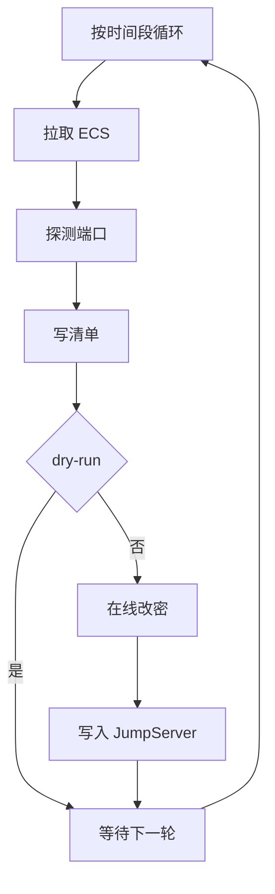

# ECS 同步到 JumpServer

扫描阿里云全部地域中带配置标签键的 ECS，探测 SSH/RDP 端口，在线修改 root 和 Administrator 密码，再把主机、账号和资产授权写入 JumpServer v5.1.1 社区版。

程序会一直循环。默认每天 09:00 到 20:00（本机时间，含 09:00，不含 20:00），每 5 分钟一轮。上一轮没结束不会重叠。`Ctrl+C` 或 `SIGTERM` 停止。每轮开始前重新读配置，改周期和时间段不用重启。

## 准备

- Go 1.22 或更高版本
- 一个或多个阿里云 AccessKey。每个账号的 RAM 都需要 `ecs:DescribeRegions`、`ecs:ListTagResources`、`ecs:DescribeInstances`、`ecs:RunCommand`、`ecs:DescribeInvocationResults`
- JumpServer v5.1.1 社区版的 Private Token 或 Bearer Token。用户需要主机、账号、账号模板、资产授权、用户组的查看、新增、修改权限
- 飞书自定义机器人 webhook。正式运行必须填写；只做 dry-run 可以不填
- ECS 镜像本身允许远程登录。程序不修改 SSH/RDP 配置，也不重启实例

复制配置：

```bash
cp config.example.yaml config.yaml
```

`config.yaml`、`inventory.json`、`logs/` 和编译出的二进制不要提交。给其他阿里云账号管理员的接入步骤在 `阿里云账号接入.md`。

示例配置里的密码、AccessKey 和 Token 都是空的。正式密码只写在本机的 `config.yaml`。

## 运行

```bash
go build -o sync ./cmd/sync
./sync
./sync start -config config.yaml
```

不带参数只显示帮助。加上 `start` 才开始循环。只扫描、探测并写清单，不改密码、不写 JumpServer：

```bash
./sync start -config config.yaml -dry-run
```

在 Linux 上交叉编译：

```bash
GOOS=linux GOARCH=amd64 go build -o sync ./cmd/sync
```

环境变量可以覆盖配置里的同名字段：`ALIYUN_ACCESS_KEY_ID`、`ALIYUN_ACCESS_KEY_SECRET`、`JUMPSERVER_BASE_URL`、`JUMPSERVER_TOKEN`、`JUMPSERVER_ORG_ID`、`FEISHU_WEBHOOK`、`FEISHU_SECRET`。

## 核心调用

时间段内才跑一轮。dry-run 写完清单就停。正式运行会改密，再把主机和账号写入 JumpServer。失败会发飞书。



## 每轮做什么

1. 按每个阿里云账号列出支持 ECS 的地域，再按同一个 `aliyun.tag_key` 找出全部标签值的实例，并分批读取实例详情。`blacklist` 里的实例 ID 在读详情前丢掉，不探测、不改密、不写入 JumpServer，也不告警。单个账号或地域失败不影响其他账号和地域。改密使用这台机器所属账号的 AccessKey。
2. 按 `probe.linux_ports` 和 `probe.windows_ports` 探测。先内网，再外网，同一侧按列表顺序。默认 Linux 是 22、2221，Windows 是 3389。探测失败仍继续，并给飞书发一条消息。探测失败时，JumpServer 协议端口用该系统列表里的第一个。
3. 不是 `Running` 的实例不改密、不写入 JumpServer，并发飞书。
4. 对仍要处理的实例，用云助手在线改密。Linux 改 root，Windows 改 Administrator，不重启。云助手不在线时不写入 JumpServer。其他改密失败仍写入主机，但不关联账号。
5. 在 JumpServer 准备两套账号模板，再按 ECS 名称新建或更新主机，并把登录账号关联到对应模板。然后按标签值授权：值为 `test` 时进入 `asset_permissions_test` 和 `user_group_test`，其他值同样用值拼出授权和用户组名称。所有带 `jms-manage` 的主机再进入 `asset_permissions_admin` 和 `user_group_admin`。值为空或 `admin`，或值不能作为名称时，只进入管理员组。动作是全部。同名用户组已存在时直接使用，不存在时按名称创建，不改组里的成员。

主机名称使用 ECS 的 `InstanceName`，最长 128 个字符。同一组织内名称必须唯一。地址优先用探测成功的一侧；探测失败时优先内网。公网和内网还会写入标签；IPv6 含冒号，不能做标签，只写进程序维护的备注。已有人工备注时不会覆盖。节点只在新建时设置，之后不移动。

## 账号和密码

密码写在配置里，不写入 `inventory.json`，也不会出现在错误日志中。

```yaml
password_reset:
  enabled: true
  password: ""
```

Linux root 与 Windows Administrator 使用同一个密码。密码 8 到 30 位，至少包含大写、小写、数字、特殊字符中的三类，不能以 `/` 开头。

JumpServer 不能让一个账号同时属于多台主机。程序创建两套模板，密码只保存在模板上：

- `ecs-linux-root`，用户名 `root`
- `ecs-windows-administrator`，用户名 `Administrator`

每台改密成功的主机仍有自己的一条账号，并跟随对应模板。已经跟随同一模板时不会重复创建。模板的自动推送和立即推送都关闭，JumpServer 不会把密码再推回机器。

改密开启时，每轮都会先按配置更新这两套模板。某一台改密失败时，它的系统密码可能还是旧的，但 JumpServer 里跟随该模板的账号已经是配置中的密码。

## 什么情况不加入 JumpServer

- 实例状态不是 `Running`
- 云助手返回 `ClientNotRunning`、`ClientNotResponse`、`ClientNotOnline` 或 `DeliveryTimeout`

端口探测失败、命令执行失败、安全组拒绝、助手正在升级，以及其他写入失败，主机仍按上述规则同步，同时发飞书。飞书发送失败会使这一轮以非零状态结束，主循环继续下一轮。

## 配置说明

时间段不能跨过午夜。`09:00` 在 YAML 里要加引号。

```yaml
interval: 5m
window_start: "09:00"
window_end: "20:00"

aliyun:
  tag_key: jms-manage
  bootstrap_endpoint: ecs.cn-hangzhou.aliyuncs.com
  accounts:
    - name: account-a
      access_key_id: ""
      access_key_secret: ""
    - name: account-b
      access_key_id: ""
      access_key_secret: ""

blacklist: []

jumpserver:
  base_url: https://jumpserver.example.com
  token: ""
  auth_scheme: Bearer
  org_id: ""
  linux_platform_id: 0
  windows_platform_id: 0
  linux_platform_name: Linux
  windows_platform_name: Windows
  nodes_display: []

feishu:
  webhook: ""
  secret: ""

output:
  inventory: inventory.json
  error_log: logs/sync-error.log
```

社区版把 `org_id` 留空。Private Token 把 `auth_scheme` 改成 `Token`。平台 ID 为 0 时按名称查找，平台类别必须是 host。`nodes_display` 是节点全路径，例如 `/Default/ECS`，节点不存在时由 JumpServer 创建。

`inventory.json` 是本机每轮覆盖的清单，JumpServer 不读它。里面没有密码。

## 测试

```bash
go test ./...
```
